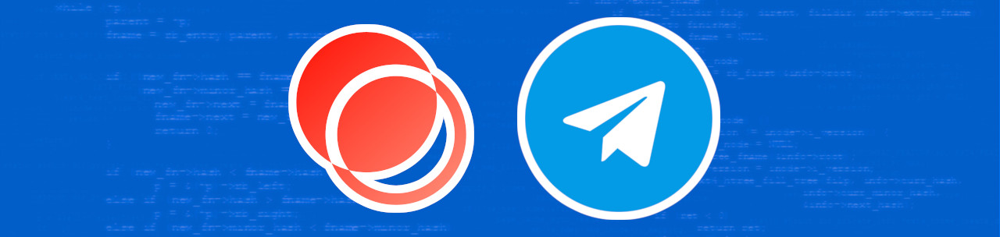
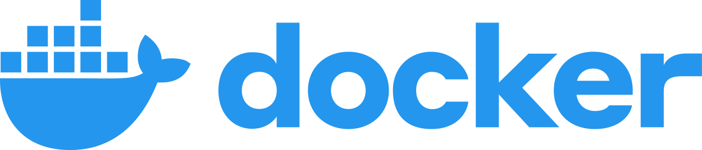

# Unthread Telegram Bot 🎫🤖

> [!WARNING]
> **Maintenance mode:** Sponsorship for this project has ended, and maintainer time is limited. No new features or improvements are planned. Security and bug fixes will continue until this integration is archived. It may be archived later, but it is not archived now.

<p align="center">
  <a href="https://github.com/wgtechlabs/unthread-telegram-bot"></a>
</p>

<p align="center">
  <strong>Official Unthread Extension</strong> — The Unthread Telegram Bot is the official integration that connects your customer and partner Telegram chats with Unthread's comprehensive ticket management system. Create and manage support tickets directly within dedicated Telegram groups, with real-time bidirectional communication between your team and clients.
</p>

<p align="center">
  [](https://github.com/wgtechlabs) [](https://unthread.com)<br>
  [](https://github.com/wgtechlabs/unthread-telegram-bot/actions/workflows/build-flow.yml) [](https://github.com/wgtechlabs/unthread-telegram-bot/actions/workflows/build-flow.yml) [](https://github.com/sponsors/wgtechlabs) [](https://github.com/wgtechlabs/unthread-telegram-bot/releases) [](https://github.com/wgtechlabs/unthread-telegram-bot/stargazers) [](https://github.com/wgtechlabs/unthread-telegram-bot/blob/main/LICENSE)
</p>

## 💎 Sponsors & Partners

<table>
  <tr>
    <td width="50%" align="center">
      <a href="https://railway.com"><picture><source media="(prefers-color-scheme: dark)" srcset="./.github/assets/sponsors/railway-logotype-light.svg"></picture></a>
      <p>Cloud platform for deploying and hosting apps, databases, and infrastructure.</p>
    </td>
    <td width="50%" align="center">
      <a href="https://www.docker.com"></a>
      <p>Platform for building, sharing, and running containerized applications.</p>
    </td>
  </tr>
</table>

This bot is designed for businesses managing customer support through private Telegram groups or dedicated partner channels - optimized for professional support workflows rather than public community groups.

> **🔄 Upgrading from Beta to v1.0.0?** Check our comprehensive [Migration Guide](./docs/migration.md) for step-by-step instructions on breaking changes and new features.


## ✨ Features

- Create and manage support tickets directly within dedicated Telegram groups.
- Keep real-time, bidirectional conversations between your team and clients.
- Designed for private Telegram groups or dedicated partner channels, not public community groups.

## 📖 Documentation

Comprehensive documentation is organized into focused guides:

- **[📋 Overview](./docs/overview.md)** - How It Works & Key Features
- **[🚀 Installation Guide](./docs/installation.md)** - Complete Setup Guide with deployment options
- **[🕹️ Usage Guide](./docs/usage.md)** - User Guide, Commands & Workflows
- **[🔧 Troubleshooting](./docs/troubleshooting.md)** - Common Issues & Solutions
- **[🏗️ Architecture](./docs/architecture.md)** - Technical Details & System Architecture
- **[🛡️ Security Policy](./SECURITY.md)** - Security Features & Vulnerability Reporting

## 🚀 Quick Start

Ready to get started? Here's the fastest way to deploy your bot:

1. **Get Bot Token**: Message [@BotFather](https://t.me/botfather) → `/newbot`
2. **Get User ID**: Message [@userinfobot](https://t.me/userinfobot) (required for admin access)
3. **[One-Click Deploy on Railway](https://railway.com/deploy/unthread-telegram-bot?referralCode=dTwT-i)** 
4. **Configure Environment**: Add your tokens and user ID to the Railway environment
   > ⚠️ **Important**: While Railway provides one-click deployment, you must supply the required environment variables (bot token, user ID, API keys) to make the bot functional.
5. **Test**: Add bot to a group and try `/support`

For detailed setup instructions, Docker deployment, and manual installation, see the complete [Installation Guide](./docs/installation.md).

### 🐳 Docker Quick Reference

For local development with Docker Compose:

```bash
# Start all services
docker compose up -d

# View logs
docker compose logs -f server

# Reset everything (fresh start with clean databases)
docker compose down -v && docker compose up -d
```

> **💡 Tip**: Use `docker compose down -v` to completely reset your local environment. This is safe for development and useful after version upgrades or when you need a clean slate.

## 💬 Community Discussions

Join our community discussions to get help, share ideas, and connect with other users:

- 📣 **[Announcements](https://github.com/wgtechlabs/unthread-telegram-bot/discussions/categories/announcements)**: Official updates from the maintainer
- 📸 **[Showcase](https://github.com/wgtechlabs/unthread-telegram-bot/discussions/categories/showcase)**: Show and tell your implementation
- 💖 **[Wall of Love](https://github.com/wgtechlabs/unthread-telegram-bot/discussions/categories/wall-of-love)**: Share your experience with the bot
- 🛟 **[Help & Support](https://github.com/wgtechlabs/unthread-telegram-bot/discussions/categories/help-support)**: Get assistance from the community
- 🧠 **[Ideas](https://github.com/wgtechlabs/unthread-telegram-bot/discussions/categories/ideas)**: Feature requests and improvements are not planned during maintenance mode

## 🛟 Help & Support

Need help? Check our [Help & Support](https://github.com/wgtechlabs/unthread-telegram-bot/discussions/categories/help-support) discussions, review the [Documentation](./docs/), or [create a new issue](https://github.com/wgtechlabs/unthread-telegram-bot/issues/new/choose).

For security vulnerabilities, follow our [security policy](./SECURITY.md).

## 🎯 Contributing

**Important**: All pull requests must be submitted to the `dev` branch. PRs to `main` will be automatically rejected.

Security and bug-fix contributions are welcome during maintenance mode. Your code must pass `bun run build` and `bun run type-check` before merging.

### Runtime And Toolchain

- Node.js is the runtime engine and supports majors 22, 24, and 26.
- Node.js 26 is the default production runtime.
- Bun is the supported installation and development toolchain (`bun install`, `bun run`).
- CI validates compatibility across Node.js 22, 24, and 26.

For detailed setup instructions, development guidelines, and security practices, see our comprehensive [Contributing Guide](./CONTRIBUTING.md).

## 💖 Support the Project

Like this project? **Leave a star**! ⭐⭐⭐⭐⭐

There are several ways you can support this project:

- [Become a sponsor](https://github.com/sponsors/wgtechlabs) and get some perks! 💖
- [Buy me a coffee](https://buymeacoffee.com/wgtechlabs) if you just love what I do! ☕
- Deploy using the [Railway Template](https://railway.com/deploy/unthread-telegram-bot?referralCode=dTwT-i) for a hosted setup. 🛠️

## ⭐ GitHub Star Nomination

Found this project helpful? Consider nominating me **(@warengonzaga)** for the [GitHub Star program](https://stars.github.com/nominate/)! This recognition supports continued maintenance of this integration and [my other open-source projects](https://github.com/warengonzaga?tab=repositories). GitHub Stars are recognized for their significant contributions to the developer community - your nomination makes a difference and helps keep maintenance work visible.

## 📋 Code of Conduct

I'm committed to providing a welcoming and inclusive environment for all contributors and users. Please review the project's [Code of Conduct](./CODE_OF_CONDUCT.md) to understand the community standards and expectations for participation.

## 📃 License

This project is licensed under the [GNU General Public License v3.0](https://opensource.org/licenses/GPL-3.0). This license ensures that the software remains free and open source, requiring that any redistributed versions also remain under the same license. See the [LICENSE](LICENSE) file for the full license text.

## 📝 Author

This project is created by **[Waren Gonzaga](https://github.com/warengonzaga)** under [WG Technology Labs](https://github.com/wgtechlabs), with the help of awesome [contributors](https://github.com/wgtechlabs/unthread-telegram-bot/graphs/contributors).

[](https://github.com/wgtechlabs/unthread-telegram-bot/graphs/contributors)

---

💻 with ❤️ by [Waren Gonzaga](https://warengonzaga.com) under [WG Technology Labs](https://wgtechlabs.com), and [Him](https://www.youtube.com/watch?v=HHrxS4diLew&t=44s) 🙏
